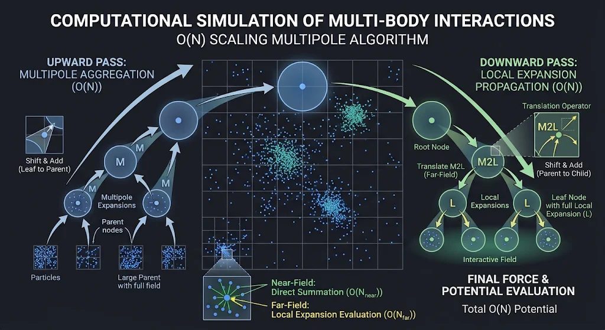

<p align="center">

</p>

# Multipole

**Multipole** is an $O(N)$ N-body simulation framework based on a hierarchical multipole algorithm. It computes interparticle gravitational or electrostatic potentials and forces (the $1/r$ kernel) for a system of $N$ particles to a user-specified precision, which can approach machine round-off. Because the cost grows linearly with $N$ rather than as $N^2$ (as in direct summation), systems of hundreds of thousands to millions of particles (more than $500{,}000$ atoms, for example) become practical.

This matters most for dynamics. Realistic simulations typically need thousands to millions of time steps, and the force calculation is repeated at every step. Linear scaling therefore reduces total runtime by orders of magnitude, making long-timescale, large-scale many-body simulations feasible.

## Contents

1. [Algorithmic overview](#1-algorithmic-overview-near-field-vs-far-field)
2. [The two-phase hierarchical process](#2-the-two-phase-hierarchical-process)
3. [Final force and potential evaluation](#3-final-force-and-potential-evaluation)
4. [Accuracy and cost](#4-accuracy-and-cost)
5. [Build and run](#5-build-and-run)
6. [References](#6-references)

---

## 1. Algorithmic Overview: Near-Field vs. Far-Field

The algorithm splits the potential at each particle into two physical regimes:

| Regime | Source particles | Method |
| --- | --- | --- |
| **Near field** | Particles in the same cube or in adjacent cubes | Direct pairwise summation |
| **Far field** | All other particles | Compact series expansions (multipole and local) |

The far-field series converge geometrically for well-separated sources. To reach a target precision $\epsilon$, the truncation order $p$ of the expansions is chosen in advance, which bounds the error while keeping the work per cube fixed.

The far field is evaluated in $O(N)$ operations by a two-phase traversal of a spatial **octree**: an upward pass followed by a downward pass. The expansion coefficients are stored in a tetrahedral array indexed by triples $(i, j, k)$ with $i + j + k \le p$ (see the note in [References](#6-references)).

---

## 2. The Two-Phase Hierarchical Process

### Phase 1: The Upward Pass (Multipole Aggregation)

The upward pass builds a multipole expansion for every cube in the tree, from the finest level up to the root.

1. **Leaf initialization.** At the finest level of refinement, the field of each particle is expanded about the center of its leaf cube, and the contributions are summed into a single multipole expansion per leaf.
2. **Tree propagation (M2M).** Moving up one level at a time, the expansions of a node's eight children are shifted to the parent's center (a multipole-to-multipole translation) and summed.
3. **Validity.** At the end of this phase, every node at every level holds a multipole expansion of the field produced by all particles inside it. Each expansion is valid only *outside* the cube's near-field region.

### Phase 2: The Downward Pass (Local Expansion Translation)

The downward pass builds a local (Taylor) expansion for every cube, starting at the coarsest level.

1. **Root initialization.** The root has no parent and no interaction list, so its local expansion is initialized to zero.
2. **Multipole-to-local translation (M2L).** For each cube, the multipole expansions of every cube in its **interaction list** are converted to local expansions about the cube's center and summed. The interaction list consists of the children of the parent's neighbors that are not themselves neighbors of the cube. In three dimensions it contains at most $6^3 - 3^3 = 189$ cubes.
3. **Local-to-local translation (L2L).** The parent's local expansion is shifted to the center of each child cube and added to the contribution from the child's interaction list.
4. **Propagation.** Repeating this down the tree means that, at every level, a cube's local expansion represents the field of all particles *outside* the cube and its immediate neighbors.

---

## 3. Final Force and Potential Evaluation

For each leaf cube $i$ at the finest level $n$, the potential and force on every particle in the cube are assembled from two parts:

* **Far-field component.** The cube's local expansion, a $p$-term Taylor series, is evaluated directly at each particle position. This gives the contribution of all distant particles.
* **Near-field component.** Interactions between each particle in cube $i$ and the particles in the cube itself and its neighbors are computed by direct summation.

The total potential is their sum:

$$\Phi_{\text{total}} = \Phi_{\text{near-field}} + \Phi_{\text{far-field}}$$

The result is exact up to the truncation error set by $p$.

---

## 4. Accuracy and Cost

* **Linear scaling.** The number of cubes is proportional to $N$ when the tree depth is chosen so each leaf holds a roughly constant number of particles. Each cube then requires a bounded number of translations (at most 189 M2L operations, one L2L, and eight M2M contributions), so total cost grows as $O(N)$.
* **Accuracy versus speed.** Raising $p$ lowers the far-field error geometrically but increases the cost of every translation. Choose the smallest $p$ that meets your required precision.
* **Tree depth.** Deeper trees shrink the near-field (direct) work and grow the far-field work. The best depth balances the two.
<!-- TODO: add measured timings, the recommended range for p, and how depth is chosen in this implementation. -->

---

## 5. Build and Run

Compile and run the program from a terminal:

```bash
./configure
make
./multipole
```

<!-- TODO: document prerequisites (compiler, OS), command-line options, input file format, output format, and a minimal worked example. -->

---

## 6. References

The hierarchical multipole algorithm is described in detail in these technical reports:

> **"Computational Simulation of Multi-Body Interactions with O(N) Scaling"**
> Cristy and David A. Pensak, Central Research and Development, E. I. du Pont de Nemours and Company, Technical Report, June 1991.
<!-- TODO: the first author appears to be missing a given name or initials; please verify. -->

> **"An O(N) Algorithm for Three-dimensional N-body Simulations"**
> Feng Zhao, MIT Artificial Intelligence Laboratory, Technical Report 995, 1987.

*Note: The formula for the lexicographic ordering of the tetrahedral array used in this framework was derived by Richard Merrifield.*
