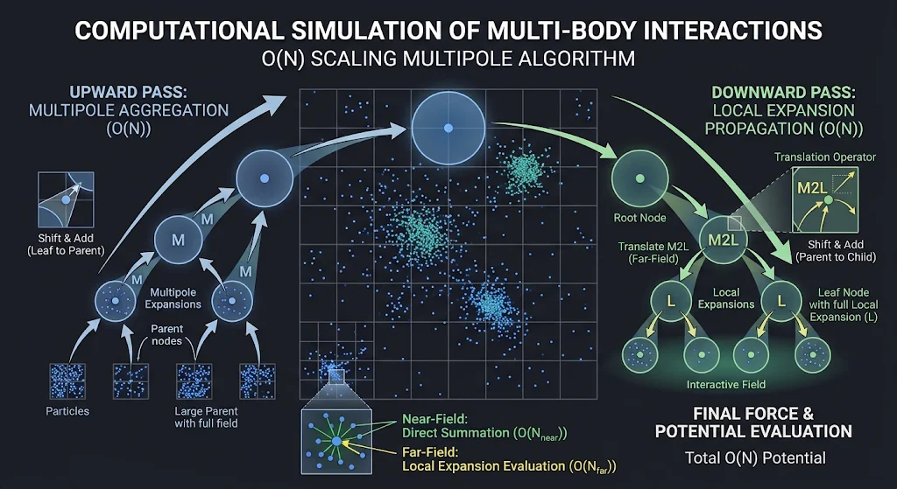

<p align="center">

</p>

Multipole is an advanced $O(N)$ N-body simulation framework utilizing a hierarchical multipole algorithm. Designed to calculate interparticle gravitational or electrostatic potentials ($1/r$) for a system of $N$ particles with precision approaching machine round-off limits, this approach achieves linear computational scaling—denoted as $O(N)$—rather than the traditional $O(N^2)$ direct-summation cost. 

This scalability enables simulations involving hundreds of thousands to millions of atoms (exceeding $500,000$ particles). Because realistic dynamic simulations frequently demand thousands to millions of time steps, linear computational complexity drastically reduces simulation runtimes, making long-timescale, large-scale multi-body dynamics feasible.

---

## 1. Algorithmic Overview: Near-Field vs. Far-Field

The multipole-expansion algorithm strategically decomposes the potential calculation into two distinct physical regimes:

* **Near-Field Interactions:** Contributions from nearby particles (immediate neighbors within adjacent cubes) evaluated via direct summation.
* **Far-Field Interactions:** Contributions from distant particles, expressed compactly as an absolutely convergent Taylor series expansion. 

To achieve a user-defined precision ($\epsilon$), the truncation order ($p$) of the Taylor series can be predetermined, bounding the computation error while optimizing performance.

The objective of the multipole computation is to evaluate the far-field with a computational effort of $O(N)$ using a two-phase hierarchical traversal across a spatial octree (or tetrahedral array structure).

---

## 2. The Two-Phase Hierarchical Process

### Phase 1: The Upward Pass (Multipole Aggregation)
During the upward phase, far-field interactions are calculated by shifting the multipole expansions of child nodes to the center of their parent node and summing the results. 

1. **Leaf Node Initialization:** The process begins at the finest level of refinement (leaf nodes). The multipole expansion of the field attributed to each particle is determined relative to the center of each leaf node and aggregated.
2. **Tree Propagation:** Moving upward through the hierarchy, the expansions of the eight child nodes are shifted relative to the parent's center and summed at each level.
3. **Validity Bounds:** By the end of this phase, every node at every level possesses a multipole-expansion representation of the field generated by all particles contained within its spatial boundaries. These expansions remain valid exclusively *outside* the region defined by each cube's near field.

### Phase 2: The Downward Pass (Local Expansion Translation)
During the downward phase, local expansions are generated for all cubes at every level, commencing from the coarsest level (the root node).

1. **Root Node Initialization:** The root node lacks a parent or an interactive field, meaning its local expansion is initialized to zero.
2. **Multipole-to-Local (M2L) Translation:** The far-field multipole expansions of all nodes within the interaction list (interactive field) of the current node are transformed into local expansions relative to the node's center and aggregated.
3. **Local-to-Local (L2L) Translation:** The local expansion of the parent cube is shifted to the center of the current child cube and combined with the local expansions derived from its interaction list.
4. **Systematic Propagation:** These expansions are systematically propagated down the tree, encapsulating the field contributions from all particles in the system that are *not* contained within the current node or its immediate neighbors.

---

## 3. Final Force and Potential Evaluation

Ultimately, for each cube $i$ at the finest level $n$, the local expansion is evaluated for every particle within cube $i$. 

* **Far-Field Component:** Each local expansion is characterized by the coefficients of a $p$-term Taylor series. The potential is obtained by directly evaluating this series at each particle location. Summing the local expansion at each leaf node yields the potential and force arising from all distant particles.
* **Near-Field Component:** The interactions of each particle in cube $i$ with its nearest neighbors are computed directly via direct summation and aggregated.
* **Total Potential:** Combining the far-field and near-field potentials yields the final exact potential:

$$\Phi_{\text{total}} = \Phi_{\text{near-field}} + \Phi_{\text{far-field}}$$

---

## 4. References & Contributions

A detailed discussion and formal description of the hierarchical multipole-expansion algorithm can be found in the following foundational technical reports:

> **"Computational Simulation of Multi-Body Interactions with O(N) Scaling"**  
> Cristy and David A. Pensak, Central Research and Development, E.I. Du Pont de Nemours, Technical Report, June 1991.

> **"An O(N) Algorithm for Three-dimensional N-body Simulations"**  
> Feng Zhao, MIT Artificial Intelligence Lab, Technical Report 995, 1987.

*Note: The formula for the lexicographical ordering of a tetrahedral array utilized in this framework was derived by Richard Merrifield.*

---

## 5. Build and Run the Multipole Program

To compile and execute the multipole simulation program, run the following commands in your terminal:

```bash
$ ./configure
$ make
$ ./multipole
```
